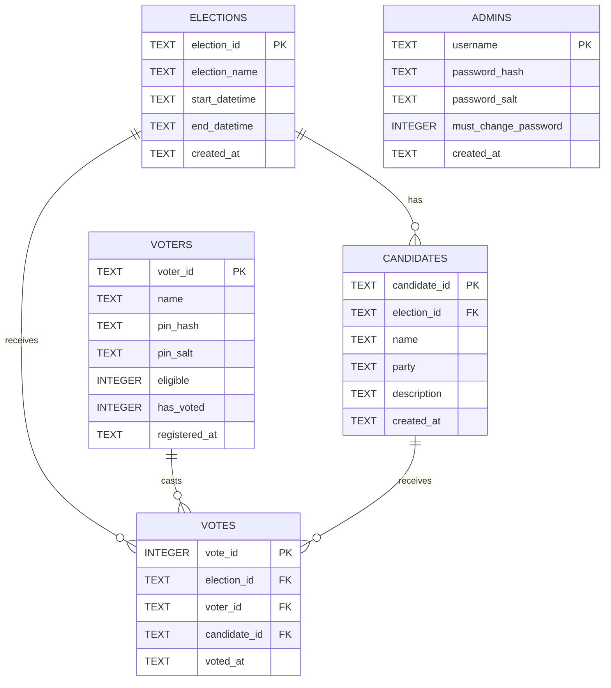

# VoteSecure — Design Document

**Project:** Online Voting System Using Object-Oriented Programming in Java
**Application name:** VoteSecure — Online Voting System
**Course:** Semester 3, Object-Oriented Programming
**Submitted:** 30 October 2026

---

## 1. Abstract

VoteSecure is a local desktop application that manages a single campus election end to end. An
administrator registers eligible voters, prepares the ballot and sets the voting window. Voters
sign in with an ID and PIN, choose one candidate and receive an on-screen confirmation that the
ballot has been stored. Results are computed from saved ballots and can be exported as a text
file or a spreadsheet-friendly CSV file.

The project demonstrates the four pillars of object-oriented programming on a realistic problem
rather than a toy one: encapsulation through models and services, abstraction through repository
interfaces, inheritance through a common exception hierarchy, and polymorphism through repository
implementations and reusable Swing components. Persistence uses JDBC with an embedded SQLite
database. Correctness of the voting rules is protected at three levels: input validation in the
UI, business rules in the service layer, and constraints and transactions in the database.

---

## 2. Problem statement

Student-council and club elections are often run with paper slips or ad-hoc spreadsheets. These
methods suffer from:

1. Duplicate or fictitious entries that cannot be detected.
2. No reliable proof of who was eligible or whether voting was open.
3. Slow, error-prone manual counting.
4. No repeatable audit trail or exportable report.
5. Unclear handling of ties, zero votes and closed elections.

A small, offline, database-backed application can remove the manual counting and enforce the
rules consistently, while remaining simple enough to run on a single laboratory computer.

---

## 3. Objectives

- Provide a role-based desktop application with separate voter and administrator screens.
- Register voters with unique IDs, hashed PINs and an eligibility flag.
- Register candidates and schedule one election with a precise start and end time.
- Enforce one vote per voter per election even if a user double-clicks or opens two windows.
- Enforce the voting window using `start <= now < end`.
- Freeze election configuration once voting has begun, so results cannot be altered.
- Calculate counts, percentages, turnout, winner, tie and zero-vote cases correctly.
- Export the results as TXT and CSV using a normal file chooser.
- Protect credentials with salted hashing and never log or display them.
- Demonstrate OOP design, JDBC, exception handling and Swing event handling.
- Verify behaviour with automated tests using isolated databases and a controllable clock.

---

## 4. Scope

### Included

- One current election at a time (the most recently created election record).
- Registration and search of voters; add/edit/delete of candidates before voting.
- Voting window configuration; configuration freeze after the first ballot.
- Voter sign-in, ballot, confirmation and success screens.
- Live administrator results and publicly published results after the election closes.
- TXT/CSV export through `JFileChooser`.
- Administrator password change.
- Automated tests, sample reports and documentation.

### Excluded (and why)

| Excluded | Reason |
| --- | --- |
| Network or web access | The brief requires a local Windows application; adding a server would introduce deployment and security scope beyond Semester 3. |
| Multiple simultaneous elections | The brief describes one election workflow; a single current election keeps the rules and UI unambiguous. |
| Voter self-registration | Eligibility must be controlled by an administrator. |
| Ballot secrecy against database administrators | Prevent duplicate voting requires storing the voter-to-ballot link; the limitation is documented instead of hidden. |
| Cryptographic vote receipts / end-to-end verifiability | Requires protocols and audit infrastructure far beyond this course and would be misleading to fake. |
| Email/SMS notifications | Requires external services and credentials. |

---

## 5. Hardware and software requirements

### Development machine used

| Component | Detail |
| --- | --- |
| Operating system | Windows 11 (10.0.26300), 64-bit |
| Processor / memory | x64 machine, sufficient for a Java desktop application |
| JDK | 25.0.4.1 (project compiled with `--release 17`) |
| Build tool | Apache Maven 3.10.0 |
| Database | SQLite via `org.xerial:sqlite-jdbc:3.46.1.0` |
| Tests | JUnit Jupiter 5.10.2 |
| Presentation | Microsoft PowerPoint compatible `.pptx` |

### Minimum end-user machine

- Windows 10 or 11, 64-bit.
- Java 17 or newer (JRE is sufficient to run the JAR; JDK is needed to build).
- Approximately 60 MB of disk space (JAR + database + reports).
- A display of at least 1280×720; the UI scrolls on smaller screens.

---

## 6. Architecture

VoteSecure uses a layered architecture. Each layer depends only on the layer below it, and the
UI never executes SQL.

```
┌──────────────────────────────────────────────────────────────┐
│ ui          Swing screens, dialogs, theme, table models      │
├──────────────────────────────────────────────────────────────┤
│ service     business rules: voting, elections, admin,        │
│             authentication, results, report export           │
├──────────────────────────────────────────────────────────────┤
│ repository  interfaces + JDBC implementations (SQL only)     │
├──────────────────────────────────────────────────────────────┤
│ database    DatabaseManager, connection settings, schema     │
├──────────────────────────────────────────────────────────────┤
│ model / exception / util                                     │
└──────────────────────────────────────────────────────────────┘
```

**Dependency rules**

- `ui` → `service`, `model`, `exception`
- `service` → `repository` (interfaces), `model`, `util`, `exception`
- `repository` → `database`, `model`, `exception`
- `database` → `util`, `exception`
- `model` depends on nothing except `java.time` and the election-specific exception-free logic.

`AppContext` constructs the object graph once and hands the services to the UI. This keeps
screens free of JDBC code and makes the services easy to test with a temporary database.

### 6.1 Package responsibilities

| Package | Responsibility | Representative classes |
| --- | --- | --- |
| `com.votesecure` | Startup and composition root | `VoteSecureApp`, `AppContext` |
| `model` | Immutable domain data and simple domain rules | `Voter`, `Candidate`, `Vote`, `Election`, `ResultsSummary`, `CandidateResult`, `Administrator`, `ElectionStatus` |
| `exception` | Meaningful failure types | `VoteSecureException` (base), `ValidationException`, `AuthenticationException`, `DuplicateVoteException`, `ElectionWindowException`, `ConfigurationLockedException`, `DuplicateEntityException`, `DataAccessException`, `ExportException` |
| `util` | Cross-cutting helpers | `PasswordHasher`, `Validation`, `DateTimeUtils`, `LoggingConfig` |
| `database` | File location, connection, schema, demo seed | `DatabaseManager` |
| `repository` | Persistence contracts and JDBC implementations | `VoterRepository` / `JdbcVoterRepository`, `CandidateRepository`, `ElectionRepository`, `VoteRepository`, `AdminRepository`, `SqlErrors` |
| `service` | Use cases and business rules | `AuthenticationService`, `ElectionService`, `VotingManager`, `AdminService`, `ResultsService`, `ReportExporter` |
| `ui` | Presentation and event handling | `MainFrame`, 12 screens, `Theme`, `UiFactory`, `FlatButton`, `CardPanel`, `StatusBadge`, … |
| `tools` | Offline generators, not used at runtime by voters | `SampleReportsGenerator`, `ScreenshotTool` |

### 6.2 Class diagram (simplified)

```mermaid
classDiagram
    class Voter {
        -String voterId
        -String name
        -String pinHash
        -String pinSalt
        -boolean eligible
        -boolean hasVoted
        +isEligible() boolean
        +hasVoted() boolean
        +withVotedStatus(boolean) Voter
    }
    class Candidate {
        -String candidateId
        -String electionId
        -String name
        -String party
        -String description
        +getDisplayName() String
    }
    class Election {
        -String electionId
        -String electionName
        -LocalDateTime startDateTime
        -LocalDateTime endDateTime
        +statusAt(LocalDateTime) ElectionStatus
        +withWindow(String, LocalDateTime, LocalDateTime) Election
    }
    class Vote {
        -long voteId
        -String electionId
        -String voterId
        -String candidateId
        -LocalDateTime votedAt
    }
    class ResultsSummary {
        -Election election
        -ElectionStatus status
        -LocalDateTime generatedAt
        -int eligibleVoters
        -int votesCast
        -double turnoutPercentage
        -List~CandidateResult~ candidateResults
        -List~String~ winnerNames
        -boolean tie
        +getOutcomeText() String
        +hasVotes() boolean
    }
    class VotingManager {
        -VoterRepository voters
        -CandidateRepository candidates
        -VoteRepository votes
        -ElectionService electionService
        -AuthenticationService authenticationService
        -ResultsService resultsService
        -ReportExporter reportExporter
        -Clock clock
        +castVote(String, String) Vote
        +calculateResults() ResultsSummary
        +exportTextReport(ResultsSummary, Path, String)
        +exportCsvReport(ResultsSummary, Path, String)
    }
    class ElectionService {
        -ElectionRepository elections
        -VoteRepository votes
        -Clock clock
        +getCurrentElection() Election
        +getCurrentStatus() ElectionStatus
        +isConfigurationLocked(Election) boolean
        +updateElection(Election) void
    }
    class ResultsService {
        -CandidateRepository candidates
        -VoteRepository votes
        -VoterRepository voters
        -Clock clock
        +buildSummary(Election) ResultsSummary
    }
    class ReportExporter {
        +exportText(ResultsSummary, Path, String) void
        +exportCsv(ResultsSummary, Path, String) void
        +buildText(ResultsSummary, String) String
        +buildCsv(ResultsSummary, String) String
    }
    class AdminService {
        +registerVoter(String, String, String, boolean) Voter
        +addCandidate(String, String, String, String) Candidate
        +updateCandidate(String, String, String, String) Candidate
        +deleteCandidate(String) void
        +updateElectionSettings(String, LocalDateTime, LocalDateTime) Election
        +changeAdministratorPassword(String, String, String) void
    }
    class AuthenticationService {
        +authenticateVoter(String, String) Voter
        +authenticateAdministrator(String, String) Administrator
    }
    class PasswordHasher {
        +newSalt() String
        +hash(String, String) String
        +verify(String, String, String) boolean
    }
    class VoterRepository {
        <<interface>>
        +findById(String) Optional~Voter~
        +save(Voter) void
        +search(String) List~Voter~
        +markVoted(String) void
        +countEligible() int
    }
    class VoteRepository {
        <<interface>>
        +castVote(String, String, String, LocalDateTime) long
        +hasVoted(String, String) boolean
        +countByElection(String) int
        +countByCandidate(String) int
    }

    VotingManager --> VoterRepository
    VotingManager --> CandidateRepository
    VotingManager --> VoteRepository
    VotingManager --> ElectionService
    VotingManager --> AuthenticationService
    VotingManager --> ResultsService
    VotingManager --> ReportExporter
    ResultsService --> VoteRepository
    ResultsService --> CandidateRepository
    ResultsService --> VoterRepository
    ElectionService --> ElectionRepository
    ElectionService --> VoteRepository
    AdminService --> ElectionService
    AuthenticationService --> VoterRepository
    AuthenticationService --> AdminRepository
    AuthenticationService --> PasswordHasher
    ResultsSummary *-- CandidateResult
    ResultsSummary --> Election
```



*(A full rendered diagram is not required; the source uses `mermaid` syntax so it can be pasted
into any Mermaid viewer.)*

---

## 7. Key design decisions

### 7.1 Single current election

`ElectionRepository.findCurrent()` returns the election with the latest `created_at`. This keeps
the voter experience unambiguous: there is always exactly one ballot, one window and one set of
results. The schema still allows several election rows, so a future version could add an
election selector without a redesign.

### 7.2 Interfaces for repositories

Repository interfaces separate *what* persistence is needed from *how* SQLite implements it.
The services are written against `VoterRepository` and `VoteRepository`, not concrete classes.
This supports polymorphism and would allow an in-memory repository for fast tests or a different
database later. The JDBC implementations keep all SQL and `PreparedStatement` usage together.

### 7.3 Service-owned business rules

The UI is deliberately thin. It validates obvious input for fast feedback, but every rule is
re-checked in the service layer:

- eligibility,
- the voting window,
- duplicate votes,
- candidate membership in the current election,
- configuration freeze.

This prevents a bypass through a different screen and makes the rules testable without a GUI.

### 7.4 Defence in depth for duplicate votes

1. `Voter.hasVoted()` and `VoteRepository.hasVoted()` are checked before insertion.
2. `VotingManager.castVote` is `synchronized` so two clicks in the same JVM serialise.
3. The `votes` table has `UNIQUE (election_id, voter_id)`, so even a second application instance
   cannot insert a second ballot. `Votes.castVote` runs in a transaction together with
   `voters.has_voted = 1`; failure rolls both back.

### 7.5 Injected clock

Every time-dependent decision accepts a `java.time.Clock`. Production uses
`Clock.systemDefaultZone()`; tests use a `MutableClock` that can jump to the exact start time,
one second before the end, the exact end time, and so on. This makes boundary testing exact
instead of sleeping in tests.

### 7.6 Configuration freeze

`ElectionService.isConfigurationLocked` returns true when at least one ballot exists **or** when
`now >= end`. Changing candidates or the window after a ballot would make the stored result
meaningless, so both the UI buttons and the service reject the change. Before the first vote an
administrator may still correct a typo or move the window.

### 7.7 Presentation theme

A small custom Swing theme (`Theme`, `FlatButton`, `CardPanel`, `StatusBadge`, `UiFactory`)
provides a consistent look without external UI libraries. HTML labels are wrapped in a
single-cell table with an explicit `width`, because Swing's HTML renderer treats a `body` width
as a hint and can overflow a card.

---

## 8. Database design

The database is an embedded SQLite file at `%USERPROFILE%\.votesecure\votesecure.db`. It is
created automatically. Foreign keys are enabled on every connection
(`PRAGMA foreign_keys = ON`), WAL journaling is enabled, and a 5-second busy timeout lets a
second window wait instead of failing immediately.

### 8.1 Entity-relationship diagram



### 8.2 Tables

#### `elections`

| Column | Type | Constraints | Notes |
| --- | --- | --- | --- |
| `election_id` | TEXT | PRIMARY KEY | e.g. `E2026` |
| `election_name` | TEXT | NOT NULL | Displayed on all screens |
| `start_datetime` | TEXT | NOT NULL | ISO-8601 local date-time |
| `end_datetime` | TEXT | NOT NULL | ISO-8601 local date-time, exclusive |
| `created_at` | TEXT | NOT NULL | Used to choose the current election |

#### `voters`

| Column | Type | Constraints | Notes |
| --- | --- | --- | --- |
| `voter_id` | TEXT | PRIMARY KEY | Normalised to uppercase |
| `name` | TEXT | NOT NULL | 2–80 letters/spaces/`.'-` |
| `pin_hash` | TEXT | NOT NULL | Base64 PBKDF2 hash |
| `pin_salt` | TEXT | NOT NULL | Base64 16-byte salt |
| `eligible` | INTEGER | NOT NULL, CHECK 0/1 | Ineligible voters cannot vote |
| `has_voted` | INTEGER | NOT NULL, CHECK 0/1 | Denormalised convenience flag |
| `registered_at` | TEXT | NOT NULL | ISO-8601 |

#### `candidates`

| Column | Type | Constraints |
| --- | --- | --- |
| `candidate_id` | TEXT | PRIMARY KEY |
| `election_id` | TEXT | NOT NULL, FK → `elections` ON DELETE CASCADE |
| `name` | TEXT | NOT NULL |
| `party` | TEXT | NOT NULL |
| `description` | TEXT | NOT NULL DEFAULT '' |
| `created_at` | TEXT | NOT NULL |

#### `votes`

| Column | Type | Constraints |
| --- | --- | --- |
| `vote_id` | INTEGER | PRIMARY KEY AUTOINCREMENT |
| `election_id` | TEXT | NOT NULL, FK → `elections` ON DELETE RESTRICT |
| `voter_id` | TEXT | NOT NULL, FK → `voters` ON DELETE RESTRICT |
| `candidate_id` | TEXT | NOT NULL, FK → `candidates` ON DELETE RESTRICT |
| `voted_at` | TEXT | NOT NULL |

Table constraint:

```sql
CONSTRAINT one_vote_per_voter_per_election UNIQUE (election_id, voter_id)
```

`ON DELETE RESTRICT` is intentional: a candidate or voter who has a ballot cannot be deleted.
Candidates are deleted only while the configuration is unlocked, which also means no votes exist.

#### `admins`

| Column | Type | Constraints |
| --- | --- | --- |
| `username` | TEXT | PRIMARY KEY |
| `password_hash` | TEXT | NOT NULL |
| `password_salt` | TEXT | NOT NULL |
| `must_change_password` | INTEGER | NOT NULL, CHECK 0/1 |
| `created_at` | TEXT | NOT NULL |

### 8.3 Indexes

- `idx_candidates_election (election_id)`
- `idx_votes_election (election_id)`
- `idx_votes_candidate (candidate_id)`

These keep counting queries fast even with a large voter roll.

### 8.4 Why `has_voted` exists alongside the `votes` table

The `votes` table is authoritative because of its unique constraint. `voters.has_voted` is a
convenience flag used by list screens. The transaction sets both; a test deliberately resets the
flag to prove that the database constraint still blocks a duplicate ballot.

---

## 9. Voting workflow

```mermaid
sequenceDiagram
    actor V as Voter
    participant UI as VotePanel
    participant VM as VotingManager
    participant ES as ElectionService
    participant VR as VoterRepository
    participant CR as CandidateRepository
    participant VTR as VoteRepository
    participant DB as SQLite

    V->>UI: Select candidate, press "Review and submit"
    UI->>UI: Show confirmation dialog
    V->>UI: Confirm
    UI->>VM: castVote(voterId, candidateId)
    VM->>VM: Normalise IDs, reject blanks
    VM->>ES: getCurrentElection()
    ES-->>VM: Election
    VM->>VR: findById(voterId)
    VR-->>VM: Voter
    VM->>VM: Check eligibility
    VM->>VM: Check start <= now < end
    VM->>VTR: hasVoted(electionId, voterId)
    VTR-->>VM: false
    VM->>CR: findById(candidateId)
    CR-->>VM: Candidate
    VM->>VM: Check candidate belongs to election
    VM->>VTR: castVote(...)
    VTR->>DB: BEGIN; INSERT vote; UPDATE voter; COMMIT
    DB-->>VTR: new vote_id
    VTR-->>VM: Vote
    VM-->>UI: Vote
    UI->>UI: Show success screen (no candidate shown)
```

**Failure paths**

| Condition | Exception | User message |
| --- | --- | --- |
| Blank voter / candidate | `ValidationException` | Select a candidate / sign in |
| Voter not registered | `ValidationException` | "not registered for the election" |
| Voter not eligible | `ValidationException` | "not eligible to vote" |
| Before start | `ElectionWindowException` | "Voting has not started yet…" |
| At or after end | `ElectionWindowException` | "Voting has closed…" |
| Already voted | `DuplicateVoteException` | "each voter may vote only once" |
| Unknown candidate | `ValidationException` | "selected candidate does not exist" |
| Candidate from another election | `ValidationException` | "not part of the current election" |
| Database failure | `DataAccessException` | Generic "could not save your vote" |

---

## 10. Object-oriented concepts demonstrated

| Concept | Where it is used | Why it matters |
| --- | --- | --- |
| **Encapsulation** | `Voter`, `Candidate`, `Election` keep fields private and expose validated accessors; `PasswordHasher` hides salt/iteration details; services hide SQL | Prevents inconsistent state such as a negative turnout or a raw PIN field |
| **Abstraction** | Repository interfaces (`VoterRepository`, `VoteRepository`, …) and the `Refreshable` UI interface | Callers describe intent, not storage mechanics |
| **Inheritance** | `VoteSecureException` → `ValidationException`, `AuthenticationException`, `DuplicateVoteException`, `ElectionWindowException`, `ConfigurationLockedException`, `DuplicateEntityException`, `DataAccessException`, `ExportException`; `FlatButton extends JButton`; `CardPanel extends JPanel` | A single `catch (VoteSecureException)` can present all expected failures, while specific types allow tailored messages |
| **Polymorphism** | `JdbcVoterRepository` implements `VoterRepository`; `SimpleTableModel` supplies table behaviour; custom Swing components override `paintComponent` | The service layer can use any implementation |
| **Composition** | `VotingManager` owns `ElectionService`, `ResultsService`, `ReportExporter` and repositories; `ResultsSummary` owns a list of `CandidateResult` | Business workflows are assembled from small, focused objects |
| **Immutable value objects** | `Election.withWindow`, `Voter.withVotedStatus` return new instances | Updates cannot accidentally mutate a snapshot used in results |
| **Exception handling** | Checked custom exceptions; UI catches them and shows friendly text; database errors logged separately | Users get actionable messages, developers keep stack traces |
| **Interfaces & enums** | `ElectionStatus { NOT_STARTED, OPEN, CLOSED }`, `Refreshable` | Removes boolean flags and magic strings |
| **Generics & collections** | `List<CandidateResult>`, `Optional<Voter>`, `Comparator.comparingInt` | Type-safe collections and explicit absence |
| **JDBC & transactions** | `JdbcVoteRepository`, `DatabaseManager` | Real persistence with prepared statements and rollback |
| **Event-driven GUI** | `ActionListener`, `DocumentListener`, `ListSelectionListener`, `CardLayout` | Decouples user actions from business logic |

---

## 11. Validation rules

| Field | Rule |
| --- | --- |
| Voter / candidate ID | 3–20 characters from `A–Z`, `0–9`, `_`, `-`; normalised to uppercase |
| Admin username | 3–30 lowercase letters, digits, `.`, `-`, `_` |
| Person name | 2–80 letters, spaces, `.`, `'`, `-` |
| Party | 2–80 characters, no control characters |
| Election name | 3–100 characters, no control characters |
| Description | Optional, ≤ 300 characters, no control characters |
| Voter PIN | Exactly 4–12 digits |
| Admin password | 8–64 characters, no spaces, at least one upper, lower, digit and special character |
| Election window | End strictly after start; the end instant is exclusive |
| Search box | Case-insensitive partial match on voter ID or name; blank search lists all |

Validation is centralised in `Validation` so the screens, services and tests apply the same rules.

---

## 12. Security design

### Implemented protections

- **Hashing:** PBKDF2-HMAC-SHA256, 120,000 iterations, 256-bit derived key, random 16-byte salt
  per credential, Base64 storage, `MessageDigest.isEqual` for constant-time comparison.
- **No plain-text credentials:** schema has no PIN/password column; tests assert the raw value is
  not present in the stored hash.
- **SQL injection:** every statement is a `PreparedStatement` with bound parameters. Search uses
  a bound `LIKE` value.
- **Error leakage:** `SqlErrors` maps SQLite failures to friendly types; the UI never shows raw
  SQL or stack traces; generic messages for database errors.
- **Logging:** loggers never receive a PIN or password; only aggregate/event messages are logged.
- **Referential integrity:** foreign keys on, restrictive delete rules for ballots.
- **Double voting:** service check + database unique constraint + transaction.
- **Results gating:** voter-facing results are blocked while the election is open; admin live
  results are labelled as a preview.

### Known limitations (documented, not hidden)

1. Ballot secrecy against full database access cannot be guaranteed, because the `votes` row
   links a voter to a candidate to enforce one vote.
2. The local SQLite file is protected only by the operating system account.
3. The demo administrator password is seeded and displayed in documentation; it must be changed
   for any real use.
4. No transport encryption is applicable because the application does not use a network.
5. No independent audit log, digital signature or paper trail exists.
6. There is no rate limiting or account lockout on repeated failed sign-ins.
7. The SQLite `TEXT` timestamps assume one local time zone; the UI states this.

---

## 13. Results and reporting design

`ResultsService.buildSummary` reads counts from the repository and computes:

- **Total votes:** `COUNT(*)` for the election.
- **Eligible voters:** voters with `eligible = 1`.
- **Turnout:** `totalVotes / eligibleVoters × 100`, or `0.0` when there are no eligible voters.
- **Candidate percentage:** `candidateVotes / totalVotes × 100`, or `0.0` when no ballots exist.
- **Winner:** candidates with the highest non-zero count; more than one → `tie = true` and the
  outcome text names all tied candidates. No votes → explicit "No votes have been cast" text.
- **Ordering:** descending votes, then candidate ID for stable output.

`ReportExporter` builds the same data as:

- **TXT:** title, optional sample notice, election, window, generation time, time-zone note,
  participation, fixed-width candidate table, outcome and disclaimer.
- **CSV:** UTF-8 **with BOM** so Excel opens non-ASCII names correctly, quoted fields, a blank
  line, then the candidate table and disclaimer. Tests verify quoting of commas and UTF-8 bytes.

Reports are written only to the destination chosen by the administrator; the application never
overwrites a file silently beyond the file chooser's own confirmation.

---

## 14. UI design

- `MainFrame` uses a `CardLayout` inside a scrollable card container, a top bar with role
  information and a **Sign out** action, and a single `showScreen` method for navigation.
- Screens implement `Refreshable`, so data is reloaded when a card is shown rather than at
  construction time.
- Theme: light background `#F4F7FC`, white cards with 18 px radius, primary `#1D4ED8`,
  success `#0F7B4F`, danger `#B42318`, status pills for OPEN/CLOSED/NOT STARTED.
- Forms use `GridBagLayout`; tables use `SimpleTableModel` with non-editable cells, sensible
  column widths and a striped row renderer.
- Long text is placed in an HTML label whose content cell has an explicit pixel width, which
  avoids clipping and horizontal scrolling.
- The layout was verified at 1280×720 and at the maximised size used for screenshots.

---

## 15. Testing strategy

- **Unit tests** for `PasswordHasher`, `Election`, and validation through the services.
- **Service tests** for authentication, voting workflow, results, admin operations and reports.
- **Database tests** for schema/demo-data creation and persistence across reconnects.
- **Isolation:** every test class creates a temporary directory and database via
  `TestEnvironment`; `@AfterEach` deletes it. The real `~/.votesecure/votesecure.db` is never
  touched.
- **Time control:** `MutableClock` with a fixed base instant (`2026-10-28T10:00`) and an election
  window of 09:00–17:00. Boundary tests move the clock to 09:00:00, 16:59:59 and 17:00:00.
- **Concurrency:** two `AppContext` instances share one temporary database and submit the same
  voter simultaneously; exactly one ballot must exist.
- **Rollback:** a temporary trigger forces the vote insert to fail; the test asserts that neither
  the ballot nor the `has_voted` flag remains.

Executed result at submission: **59 tests, 0 failures, 0 errors, 0 skipped.**

---

## 16. Future enhancements

1. Separate anonymous ballot table with cryptographic receipts to improve secrecy.
2. Multiple concurrent elections with an election selector.
3. Voter self-service PIN reset through a one-time code issued by the administrator.
4. Audit log of administrative actions (append-only).
5. Account lockout after repeated failed sign-ins.
6. PDF export and charts for results.
7. Migration to a client–server database with TLS for multi-machine use.
8. Accessibility review (screen-reader labels, keyboard-only navigation).

---

## 17. Conclusion

VoteSecure meets the brief with a complete, runnable desktop application. Every required screen
is implemented and reachable, the voting rules are enforced in the service layer and the
database, credentials are hashed, reports are produced from real stored data, and the behaviour
is verified by 59 automated tests. The design keeps presentation, business rules and persistence
separate, which is the central lesson of object-oriented design in this course. The known
limitations are documented candidly: this is an academic local prototype, not a production-grade
Internet voting platform.
